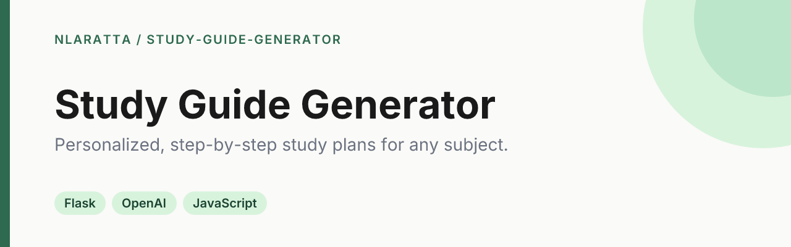

<p align="center">
  
</p>

<p align="center">
  <a href="https://github.com/nlaratta/study-guide-generator/actions/workflows/ci.yml"></a>
  <a href="LICENSE"></a>
</p>

A small Flask app that turns a subject, your current level, weekly time and learning style into a personalized six-step study guide, generated with the OpenAI API.

## Quick start

```bash
git clone https://github.com/nlaratta/study-guide-generator.git
cd study-guide-generator
uv venv && uv pip install -r requirements.txt
cp .env.example .env   # then set OPENAI_API_KEY in .env
uv run python app.py
```

Open <http://localhost:5001>.

Without uv: `python3 -m venv .venv && .venv/bin/pip install -r requirements.txt && .venv/bin/python app.py`.

Configuration is read from `.env` (see `.env.example`): `OPENAI_API_KEY` (required to generate), `OPENAI_MODEL` (default `gpt-4o`), `PORT` (default `5001`), `FLASK_DEBUG` (off by default), `DEFAULT_STEPS` (default `6`). The app starts without a key; `/generate` then returns a JSON error explaining what is missing.

Run the tests (the OpenAI client is mocked, no API calls):

```bash
uv pip install -r requirements-dev.txt && uv run pytest
```

## How it works

- Fill in a subject, current level, weekly hours, learning style and goal.
- The backend builds a six-step plan one request at a time, each step seeing the earlier ones: knowledge assessment, learning path, resources, practice framework, progress tracking and a study schedule.
- Highlight text in a step to get a deeper AI explanation in a modal.
- Progress is tracked in the browser (localStorage) and can be exported as JSON.
- Generated steps are cached in `saved_responses.json` (git-ignored) so repeat requests for the same subject and step don't call the API again.
- Frontend is plain HTML/JS with TailwindCSS and marked.js loaded from CDNs, so the browser needs internet access.

## Project structure

```
app.py              Flask backend and OpenAI calls
templates/          index.html
static/             app.js, progress-tracker.js, styles.css
tests/              pytest suite (Flask test client, mocked OpenAI)
```

## License

[MIT](LICENSE) © Noah Laratta
